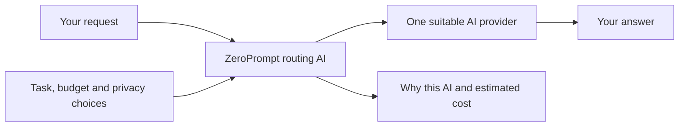

# ZeroPrompt

### A little less effort. A lot more possibility.

An ongoing undergraduate university project for an **Artificial Intelligence** course, developed by team **K³: Kai, Kass, and Kylie**. ZeroPrompt aims to help people use AI with less effort: describe what you need, and let the service choose a suitable AI for the job.

The proposed product combines an **in-house routing AI** with existing AI providers. We plan to build and train the chooser using example requests and reviewed answers, rather than create a new foundation language model.

**[Open the live demo](https://pshkai.github.io/zeroprompt/)**

**Status:** interactive product prototype. Routing, model profiles, responses, comparisons, and subscription plans are simulated. No live AI APIs or payments are connected.

Project direction updated **24 October 2026** to reflect the latest midterm proposal.


## Objectives and scope

ZeroPrompt is for **students, freelancers, small teams, and the general public**. Its objectives are to help users spend less, find the right AI, and save time choosing services.

The proposed scope includes writing, summaries, problem-solving, code, research, law, finance, analysis, design, images, and app actions. These describe the intended product; the current website demonstrates a smaller set with prepared responses. Implementation and testing will happen in stages.

## How the proposed system works



The router would understand the request, check the user's spending and information-sharing preferences, and select a suitable external AI. That provider produces the answer. ZeroPrompt explains the selection and estimated cost. If no option fits the limits, the proposed service would ask before changing them.

**Today:** the browser uses local keyword rules and authored model scores. A trained router, backend, database, and live provider connections are future work.

## Business architecture

| Area | Role in ZeroPrompt |
| --- | --- |
| Customers / Users | Students, freelancers, small teams, and the general public |
| Service Providers | AI providers supplying the models that answer requests |
| Business Operations | Model comparison, pricing and cost management, service quality and support |
| Governance | Privacy and permissions, transparent pricing |
| Business Model | Free and paid plans, subscription revenue, operating costs |
| Business Capabilities | Understand customer needs, match requests with suitable AI, explain choices and manage spending |
| Expected Customer Value | More efficient use of AI, lower overall spending, less time choosing services |

## The experience

- Three-step welcome flow ending with Free, Vibe, and God plan previews.
- A conversation workspace with left navigation, recent chats, animated prompt suggestions, and a searchable model picker.
- Auto routing by default, plus manual selection and Advanced quality/cost priorities and text-cost budget.
- A right-hand **Explain the route** drawer showing model selection, estimated tokens, illustrative cost, modeled time, fit, and alternatives.
- Account preview, Settings, Model Library, How it works, and Model Comparison.
- Comparison tabs for Coding, Agentic Tasks, Data Analysis, Research, Design, Cost per Task, Context Window, and Model time, including technical, legal, research, and document subtasks.
- Agentic Tasks categories: Finance & Compliance Apps, Operations & Commerce Apps, Long-Run Operations, Systems Engineering, and Performance Optimisation. All comparison scores are illustrative.
- Keyboard navigation, responsive mobile drawers, cancellation, copy, text download, and reduced-motion support.
- Rename and delete individual conversations from their options menu, with optional persistence on the device.
- Provider logos, a compact custom desktop cursor, and viewport-fitted introductions and plan selection. On phones, plan tabs keep one plan visible at a time without page scrolling.
- Advanced routing preferences in a dropdown-style popup, with bounded image previews and responsive layouts.

## Demo catalog

| Provider | Models |
| --- | --- |
| Anthropic | Claude Opus 5.5, Claude Fable 5 |
| OpenAI | GPT-6 Astra, GPT-6.1 Sol |
| Google | Gemini 4 Argon |
| Alibaba | Qwen 3.8 |
| Moonshot AI | Kimi K3 |
| Meta | Muse Wonder 1.0 |
| DeepSeek | DeepSeek V4.1 Flash |
| SpaceX | Grok 4.7 |
| Z.ai | GLM 5.3 |
| Xiaomi | MiMo-V2.6-Pro |

Names follow the project's requested lineup as of 23 October 2026. The catalog does not verify current provider branding, API access, image generation, pricing, or context limits. Numeric profiles are authored demo fixtures, not provider specifications or measured benchmarks.

## Seven distinct demonstrations

Examples load a consistent preset: Auto, best quality, all models enabled, all providers, and a $0.050 text budget. You can then change those settings before sending.

| Demo | Default simulated selection |
| --- | --- |
| A thoughtful email | Claude Opus 5.5 |
| Work through a decision | GPT-6 Astra |
| Write a small function | GPT-6.1 Sol |
| Imagine an image | Gemini 4 Argon |
| Explore a finance scenario | Qwen 3.8 |
| Start a research plan | Claude Fable 5 |
| Understand a legal question | Kimi K3 |

The image example asks for a meme explaining the Confusion Matrix and displays the exact image supplied for this demo. It makes no image-generation API call. The coding example includes a function, assertions, and a short explanation. Finance and legal samples are educational fixtures. Research examples contain no live searches or completed findings. Every response is a prepared example, rather than an answer generated from the user's message.

## Subscription concepts

- **Free:** everyday text, limited image creation and storage, ad-supported concept.
- **Vibe:** ฿990 / $30 per month concept with advanced intelligence, agents, projects, tools, plugins, MCPs, and no ads.
- **God:** ฿3,960 / $120 per month concept with higher capacity, API credits, early access, and higher output limits.

Selecting a plan changes only the preview label. It creates no payment, subscription, entitlement, or credit balance. No ads, agents, image generators, or external app connections run in this prototype.

The proposal compares approximately **฿2,097 per month** for three subscriptions with the proposed **฿990 Vibe plan**: a difference of **฿1,107, or about 53%**. This is a planning comparison using the project's approximate input, not a verified provider price comparison or measured customer saving. Whether a plan can deliver comparable service sustainably still needs testing against actual usage and operating costs.

## Research and evaluation plan

1. **Compare candidate AIs:** begin with GPT, Claude, Gemini, DeepSeek, Qwen, and Kimi families. Verify available versions, access, terms, and prices before testing. This research pool is separate from the broader illustrative website catalog.
2. **Learn to choose:** use example requests and reviewed AI answers to develop the router and its model-selection guide.
3. **Test fresh requests:** use different examples that were not used to develop the chooser. Check whether answers are correct, follow the request, cover what is needed, and are clear. Record actual cost, waiting time, and failures.
4. **Compare two approaches:** send the same requests through one selected AI service and through ZeroPrompt. Select the fixed comparison model before the final test, using earlier evaluation results.

The proposed targets are **25% less spending** and **30% less setup time**, while keeping answers useful. These are research goals, not achieved results. The subscription-price comparison above and the measured routing-cost target answer different questions.

The expected outputs are a working service, an evidence-based **AI selection guide**, a cost and quality report, and a user guide. Related work informing the proposal includes [RouteLLM](https://arxiv.org/abs/2406.18665), [FrugalGPT](https://lingjiaochen.com/papers/2024_FrugalGPT_TMLR.pdf), [Hybrid LLM](https://arxiv.org/abs/2404.14618), and [MixLLM](https://aclanthology.org/2025.naacl-long.545/).

## Proposed 12-week plan

Weeks are relative to project approval. The planning budget cap is **฿9,000**; it is not a record of spending.

| Activity | Weeks | Responsibility |
| --- | --- | --- |
| Ideation | 1 | Kai, Kass, Kylie |
| Market research | 1–3 | Kass |
| System development | 3–6 | Kai |
| UI and presentation | 3–6, 11–12 | Kylie |
| Testing and fixes | 7–9 | Kai, Kass, Kylie |
| Law and privacy review | 2–10 | Kass and Kai |
| Launch a small trial | 10 | Kai |
| Marketing and outreach | 9–12 | Kylie and Kass |
| Review results | 11–12 | Kass and Kylie |

The first version is planned for week 6, testing and fixes through week 9, and a small trial in week 10 after the necessary checks and permissions. This is the proposed development schedule; the existing static demo is already available above.

## Run locally

You need Git and Python 3. No package installation or build is required.

```sh
git clone https://github.com/pshkai/zeroprompt.git
cd zeroprompt
python -m http.server 8765 --bind 127.0.0.1 --directory dist
```

Open **http://127.0.0.1:8765/**. Use `python3` if that is your system's command. Any static HTTP server can serve `dist/`.

## Privacy and responsible AI

Chats stay in tab memory by default. **Save chats on this device** opts into browser localStorage. Disabling it removes the saved copy. Clear conversations removes both the in-memory chats and any saved copy. There is no backend, tracking, sign-in, or model API traffic. Google Fonts loads typography externally.

For the proposed connected service, we plan to explain which provider receives information, collect only what is needed, respect user permissions, and make pricing clear. Testing will include answer mistakes and bias. Applicable privacy law, cross-border data sharing, provider terms, security, and content permissions must be reviewed before an external trial. Important legal and financial answers require human review.

## Current implementation

Local keyword rules classify the request. Auto filters enabled models by provider preference and estimated text-cost budget, then ranks candidates using weighted illustrative quality, cost, and time. Manual choices respect the same constraints. This repository claims no measured benchmark findings or demonstrated savings.

Built with HTML, CSS, and vanilla JavaScript. The visual identity uses deep teal (#092328), brown (#41290d), bronze (#b27c3f), and the italic z° mark. GitHub Actions deploys `dist/` to GitHub Pages on changes to `main`.

Created by [pshkai](https://github.com/pshkai) for the K³ undergraduate Artificial Intelligence project.

Provider marks come from [Lobe Icons](https://github.com/lobehub/lobe-icons). Attribution and the upstream license are included in `dist/assets/logos/`. The confusion-matrix image is the user-provided demo asset.
