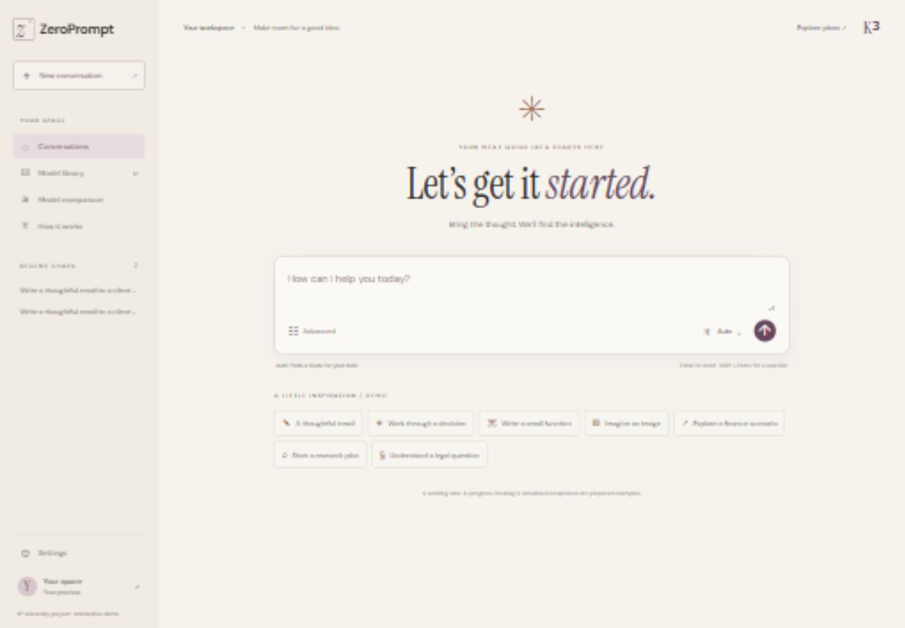

# ZeroPrompt

### A little less effort. A lot more possibility.

An ongoing undergraduate university project for an **Artificial Intelligence** course, developed by team **K³**. ZeroPrompt explores how task-aware model selection could help everyday users choose AI without understanding every provider or engineering a perfect prompt.

**[Open the live demo](https://pshkai.github.io/zeroprompt/)**

**Status:** interactive product prototype. Routing, model profiles, responses, comparisons, and subscription plans are simulated. No live AI APIs or payments are connected.



## The experience

- Three-step welcome flow ending with Free, Vibe, and God plan previews.
- A conversation workspace with left navigation, recent chats, animated prompt suggestions, and a searchable model picker.
- Auto routing by default, plus manual selection and Advanced quality/cost priorities and text-cost budget.
- A right-hand **Explain the route** drawer showing model selection, estimated tokens, illustrative cost, modeled time, fit, and alternatives.
- Account preview, Settings, Model Library, How it works, and Model Comparison.
- Comparison tabs for Coding, Data Analysis, Research, Design, Cost per Task, Context Window, and Model time, including technical, legal, research, and document subtasks.
- Keyboard navigation, responsive mobile drawers, cancellation, copy, text download, and reduced-motion support.
- Rename and delete individual conversations from their options menu, with optional persistence on the device.
- Provider logos, custom desktop cursors, and viewport-fitted introductions and plan selection. On phones, plan tabs keep one plan visible at a time without page scrolling.

## Demo catalog

| Provider | Models |
| --- | --- |
| Anthropic | Claude Opus 5.5, Claude Fable 5 |
| OpenAI | GPT-6 Astra, GPT-6.1 Sol |
| Google | Gemini 4 Argon |
| Alibaba | Qwen 3.8 |
| Moonshot AI | Kimi K3 |
| Meta | Muse Wonder 1.0 |
| DeepSeek | DeepSeek V4.1 Flash |
| SpaceX | Grok 4.7 |
| Z.ai | GLM 5.3 |
| Xiaomi | MiMo-V2.6-Pro |

Names follow the project's requested lineup as of 23 October 2026. The catalog does not verify current provider branding, API access, image generation, pricing, or context limits. Numeric profiles are authored demo fixtures, not provider specifications or measured benchmarks.

## Seven distinct demonstrations

Examples load a consistent preset: Auto, best quality, all models enabled, all providers, and a $0.050 text budget. You can then change those settings before sending.

| Demo | Default simulated selection |
| --- | --- |
| A thoughtful email | Claude Opus 5.5 |
| Work through a decision | GPT-6 Astra |
| Write a small function | GPT-6.1 Sol |
| Imagine an image | Gemini 4 Argon |
| Explore a finance scenario | Qwen 3.8 |
| Start a research plan | Claude Fable 5 |
| Understand a legal question | Kimi K3 |

The image example asks for a meme explaining the Confusion Matrix and displays the exact image supplied for this demo. It makes no image-generation API call. The coding example includes a function, assertions, and a short explanation. Finance and legal samples are educational fixtures. Research examples contain no live searches or completed findings. Every response is a prepared example, rather than an answer generated from the user's message.

## Subscription concepts

- **Free:** everyday text, limited image creation and storage, ad-supported concept.
- **Vibe:** ฿990 / $30 per month concept with advanced intelligence, agents, projects, tools, plugins, MCPs, and no ads.
- **God:** ฿3,960 / $120 per month concept with higher capacity, API credits, early access, and higher output limits.

Selecting a plan changes only the preview label. It creates no payment, subscription, entitlement, or credit balance. No ads, agents, image generators, or external app connections run in this prototype.

## Run locally

You need Git and Python 3. No package installation or build is required.

```sh
git clone https://github.com/pshkai/zeroprompt.git
cd zeroprompt
python -m http.server 8765 --bind 127.0.0.1 --directory dist
```

Open **http://127.0.0.1:8765/**. Use `python3` if that is your system's command. Any static HTTP server can serve `dist/`.

## Privacy

Chats stay in tab memory by default. **Save chats on this device** opts into browser localStorage. Disabling it removes the saved copy. Clear conversations removes both the in-memory chats and any saved copy. There is no backend, tracking, sign-in, or model API traffic. Google Fonts loads typography externally.

## Approach and next steps

Local keyword rules classify the task. Auto filters enabled models by provider preference and estimated text-cost budget, then ranks candidates using weighted illustrative quality, cost, and time. Manual choices respect the same constraints.

The academic next step is to verify an accessible model pool, define task data and scoring rubrics, and compare routing against fixed-model and cheapest-eligible baselines. Actual quality, billed cost, completion time, and failures need measurement. This repository claims no benchmark findings or demonstrated savings.

Built with HTML, CSS, and vanilla JavaScript. The visual identity uses warm paper, plum, clay, muted olive, and the italic z° mark. GitHub Actions deploys `dist/` to GitHub Pages on changes to `main`.

Created by [pshkai](https://github.com/pshkai) for the K³ undergraduate Artificial Intelligence project.

Provider marks come from [Lobe Icons](https://github.com/lobehub/lobe-icons). Attribution and the upstream license are included in `dist/assets/logos/`. The confusion-matrix image is the user-provided demo asset.
